<p align="center"></p>

# Flow: an agentic trading environment for HashKey Chain

[flowverse.cloud](https://flowverse.cloud). The code packages still use the name `ate` (Agentic Trading Environment),
for example `ate-daemon` and `ate chat`.

**Give an AI agent everything it needs to trade HSKSwap, let it run while you sleep, and know the worst case first.**

Flow is the environment around a trading agent:

- **Tools.** 16 MCP tools: live pool and oracle data, quotes and price impact, charts with indicators and analysis,
  backtests, positions and P&L, strategy settings, propose and execute, and a signed journal.
- **Connections.** Use the AI you already pay for (Claude, ChatGPT or Gemini subscriptions through CLIProxyAPI),
  OpenCode, or any MCP client such as Claude Code or Codex. No API keys are necessary.
- **Always on.** The agent trades by itself on your Mac, or in the cloud from one Docker image
  (agent, daemon, web app, passkey sign-in, managed signer). Nobody signs by hand.
- **A seatbelt.** A vault contract on HashKey Chain holds the money and checks every trade. The agent can trade inside
  your limits but can never withdraw. A bad prompt or a stolen key cannot cost more than the limit you set.

Built by team Vikings for the HSK Chain Horizon Hackathon (AI Agent Trading). Apache-2.0.

**Demo video (2:33):** <https://youtu.be/HemAPYeCcrI> · **DoraHacks:** <https://dorahacks.io/build/50869>

## How Flow meets Track 1

| Track 1 item | What Flow does | Where to see it |
|---|---|---|
| HSKSwap DEX | Each trade is a swap on an HSKSwap pool (WHSK/USDT, WBTC/USDT). The vault calls `SwapRouter02`. The output stays in the vault. | `contracts/src/PolicyVault.sol` · Blockscout links below |
| AI agent as core engine | An LLM trader (Claude, or any MCP agent) reads the market, then takes, sizes down or vetoes each candidate trade. It writes a rationale for each decision. | `agents/trader/PROMPT.md` · desktop Decisions |
| Market monitoring | The daemon reads both markets each cycle (120 s), with a fast scan each 20 s. A large gap starts a cycle at once. | `apps/daemon/src/service.ts` · desktop Trade |
| On-chain data analysis | Flow reads the pool price, the pool's 300 s TWAP, the oracle price (Supra, the price the vault checks, with an APRO cross-check), recent pool swaps and the QuoterV2 price impact. The agent charts the pool with the oracle line. Its rationale states these numbers. | `ate_market_get`, `ate_chart` · `packages/strategy/src/market.ts` · desktop Charts |
| Signal identification | `spread-revert` finds a gap between the pool and the oracle price that is larger than the fee and impact. Custom strategies add rules (EMA/SMA cross, RSI, breakouts, volatility, trend, pool volume). | `packages/strategy/src/generators.ts` · `packages/strategy/src/custom/` · desktop Strategy |
| Order execution, no manual steps | In `autonomous` mode the agent proposes and executes in the same run. The daemon signs and sends the transaction. No person clicks. | `ate_propose`, `ate_execute` · `docs/testnet-133-journal-run2.json` (71-minute unattended run) |
| Arbitrage and price spreads | The agent buys when the pool is below the oracle price and sells when it is above, if the gap is larger than the cost. The trade has one leg, on HSKSwap. | `packages/strategy/src/generators.ts` · `ate replay` |
| Strict risk control and stop-loss | On-chain: the PolicyVault limits trade size, daily spend, exposure, price deviation from the oracle and slippage, and allows one pool and one router only. Off-chain: the guard applies stop-loss, take-profit, a daily loss breaker and turnover limits. | `contracts/src/PolicyVault.sol` · `packages/strategy/src/guard.ts` · [rogue reverts](docs/JUDGE.md) |
| Natural-language view of positions and P&L | `ate chat` and the desktop Ask screen call `ate_positions`. They show realised P&L, the P&L if sold now, and the P&L at the oracle price. | `agents/chat/PROMPT.md` · desktop Ask |
| Change size, frequency, risk appetite and target assets in chat | `ate_strategy_set` changes `tradeSizeUsd` and `maxPositionUsd` (size), `cycleSeconds` (frequency), `riskProfile`, `stopLossBps` and loss limits (risk appetite) and `targetAssets`. A change that increases risk needs Touch ID or a one-time code. | `packages/strategy/src/patcher.ts` · section 9 below |

HashKey Global is optional context only. It is off by default (strategy `reference` is `"oracle"`). Every trade is on HSKSwap.

## See it working

These links are on the HashKey Chain **testnet** (chain 133), with test tokens. Click in this order.

1. [The vault](https://testnet-explorer.hskchain.net/address/0xF80A74F4D9C17Db8a2a0F32558a9FC3A63e2Bcd2?tab=contract) (Vault-HSK). Source is verified on Blockscout and [on Sourcify](https://repo.sourcify.dev/133/0xF80A74F4D9C17Db8a2a0F32558a9FC3A63e2Bcd2) (exact match).
2. [An AI trade](https://testnet-explorer.hskchain.net/tx/0x4ff2ad5176975fed3b45e5242894cce949b68b626051e82ec3d270474fde9c0d) and [its EAS attestation](https://testnet-explorer.hskchain.net/tx/0x1f042937320537b9e3b749d327eb2648613aeb1c6319a476f48341bba0a798f8).
3. [A rogue agent trade that reverted](https://testnet-explorer.hskchain.net/tx/0x0677fb8896195c736201374805876d0aa0122b0ea57ecdf08b5f78f40b531558) (bad price).
4. [Pause](https://testnet-explorer.hskchain.net/tx/0xaba62b83fd096241a703c4f4ced8b7a7eb4a3e9101a127c71c60e1c11c4a221a), then [unpause](https://testnet-explorer.hskchain.net/tx/0x530bafc2456b50dd35ee58359f02b1c4b8e44c9719f154caff7e599680f9e949) (Vault-HSK); the same on Vault-BTC: [pause](https://testnet-explorer.hskchain.net/tx/0xbfe744ebf7e53f8375c11247b5de1a721cbf0dfa8c66487a4bdacdf4cf130de6), [trade refused](https://testnet-explorer.hskchain.net/tx/0x37e290d6bc3048f77c95563c39fa0dc2d336f2628f227c7cbe9a7bdaf7c41575), [unpause](https://testnet-explorer.hskchain.net/tx/0x486ea3f24e20f3cc928b07a3c61bb2ad86ed51bbb614809a0946288066b77e61).
5. [The journal export](docs/testnet-133-journal.json) (70 records, hash chain). Recompute every hash offline: `node scripts/verify-journal.mjs`. A 71-minute unattended run continues it in [`testnet-133-journal-run2.json`](docs/testnet-133-journal-run2.json).

What each link shows: [`docs/JUDGE.md`](docs/JUDGE.md).

## Where things are

| Item | Status |
|---|---|
| Contracts | Done. 148 tests pass (5 skipped: the fork test is opt-in). An optional fork test also runs them against the real HSKSwap pools and Supra prices. |
| Testnet (chain 133) | Live. Two vaults, test tokens and pools. Addresses are in `deployments/133.json`. |
| AI trader on testnet | Ran on 2 Nov. Claude made trades, skipped trades and one veto. All are in the journal. |
| Rogue test on testnet | Done. Every attack with the stolen agent key reverted on-chain. |
| Mainnet (chain 177) | Next. The same scripts deploy it. The owner moves to a Safe after that. |
| AI trader | Claude (Sonnet) through Claude Code. You can plug in any MCP agent. |
| Result | Claude opened and closed a WBTC lot on testnet for +70 bps net, on a price gap we staged ourselves (no other traders on the test pool). All 7 attacks with the stolen key reverted. The guardian paused both vaults, and trades were refused until the owner unpaused. |
| Caveats | The price gap for the trades was staged by us, because nobody else trades the test pools. Profit is not promised. The pools are thin. What Flow gives you is a hard limit on loss. |

### Proof on testnet

These links are on the HashKey Chain **testnet** (chain 133), with test tokens.

- Vaults: Vault-HSK ([Blockscout](https://testnet-explorer.hskchain.net/address/0xF80A74F4D9C17Db8a2a0F32558a9FC3A63e2Bcd2?tab=contract), [Sourcify](https://repo.sourcify.dev/133/0xF80A74F4D9C17Db8a2a0F32558a9FC3A63e2Bcd2)) and Vault-BTC ([Blockscout](https://testnet-explorer.hskchain.net/address/0x6Da0c6EF7328d3aD6b0b8781770D941D065a6693?tab=contract), [Sourcify](https://repo.sourcify.dev/133/0x6Da0c6EF7328d3aD6b0b8781770D941D065a6693)). Both are verified on Sourcify (exact match) and on Blockscout (partial match: the upload had comments stripped to fit the explorer's 100 KB request limit, so only the metadata hash differs). Blockscout decodes every vault revert.
- A trade that Claude decided: [WBTC buy](https://testnet-explorer.hskchain.net/tx/0x4ff2ad5176975fed3b45e5242894cce949b68b626051e82ec3d270474fde9c0d). The pool price gap was staged by us, because nobody else trades on the test pools.
- The EAS attestation for that trade: [attest tx](https://testnet-explorer.hskchain.net/tx/0x1f042937320537b9e3b749d327eb2648613aeb1c6319a476f48341bba0a798f8).
- Skipped trades and the veto: in the [journal export](docs/testnet-133-journal.json) (`no_trade` records, head hash `0x5e72…ad85`).
- Rogue agent reverts: [trade too big](https://testnet-explorer.hskchain.net/tx/0x7213dfc80d876804e3232bc572b2ecc99faae25f75e4457da71b8616ca091e24), [bad price](https://testnet-explorer.hskchain.net/tx/0x0677fb8896195c736201374805876d0aa0122b0ea57ecdf08b5f78f40b531558), [withdraw](https://testnet-explorer.hskchain.net/tx/0x6f5d929c9591a028c811eb7f841cc77bf435619f799b344f8ff4881cfb139a8c).
- Kill switch, Vault-HSK: [guardian pause](https://testnet-explorer.hskchain.net/tx/0xaba62b83fd096241a703c4f4ced8b7a7eb4a3e9101a127c71c60e1c11c4a221a), [trade refused while paused](https://testnet-explorer.hskchain.net/tx/0x62f96834dfa5ff64bb0ddd378c56f2a42d5b83b96d951f7a0803ca6029b31a8b), [owner unpause](https://testnet-explorer.hskchain.net/tx/0x530bafc2456b50dd35ee58359f02b1c4b8e44c9719f154caff7e599680f9e949). Vault-BTC: [guardian pause](https://testnet-explorer.hskchain.net/tx/0xbfe744ebf7e53f8375c11247b5de1a721cbf0dfa8c66487a4bdacdf4cf130de6), [trade refused while paused](https://testnet-explorer.hskchain.net/tx/0x37e290d6bc3048f77c95563c39fa0dc2d336f2628f227c7cbe9a7bdaf7c41575), [owner unpause](https://testnet-explorer.hskchain.net/tx/0x486ea3f24e20f3cc928b07a3c61bb2ad86ed51bbb614809a0946288066b77e61).

All links, with what each one shows: [`docs/JUDGE.md`](docs/JUDGE.md).

## Why a vault, and not a normal wallet

| What you want | Token allowance | Safe module or session key | Flow PolicyVault |
|---|---|---|---|
| Limit on trade size and daily spend | No | Yes | Yes |
| Refuse a trade at a bad price | No | No | Yes, from an oracle price |
| Only one pool, one oracle, one router | No | Partly | Yes, fixed at deploy |
| Limit on how much of a token the agent holds | No | No | Yes |
| A record of why each trade happened | No | No | Yes, hash on-chain |
| Works with any AI agent through MCP | No | No | Yes |

More detail: [`SPEC.md`](SPEC.md) (full design) · [`docs/JUDGE.md`](docs/JUDGE.md) (links to transactions and proofs) · [`docs/replay-7d.md`](docs/replay-7d.md) (7-day market replay).

---

## See it

| Decisions: every trade and every skipped trade, with the reason | Chat: control the agent in plain language |
|---|---|
| 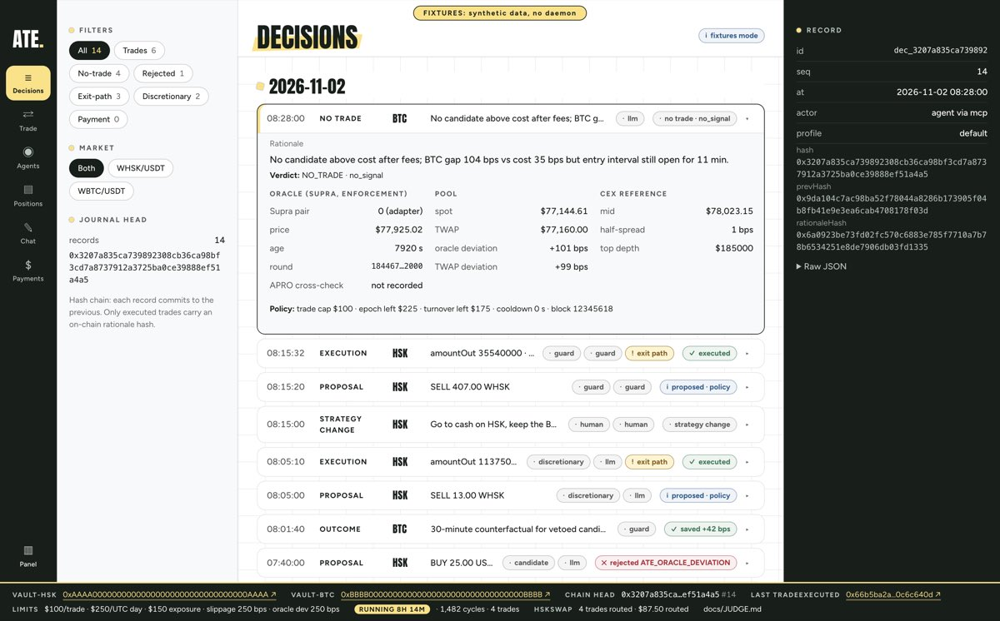 | 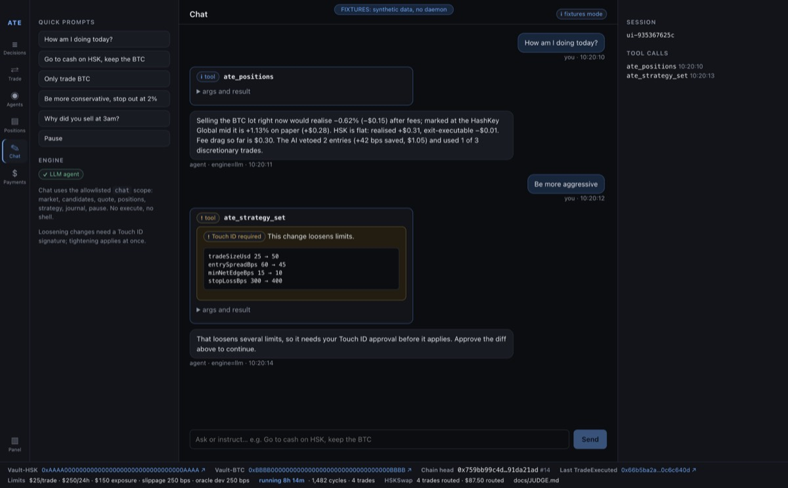 |
| **Trade: quote, policy checks and the oracle price** | **Agents: trader status, budgets and the kill switch** |
| 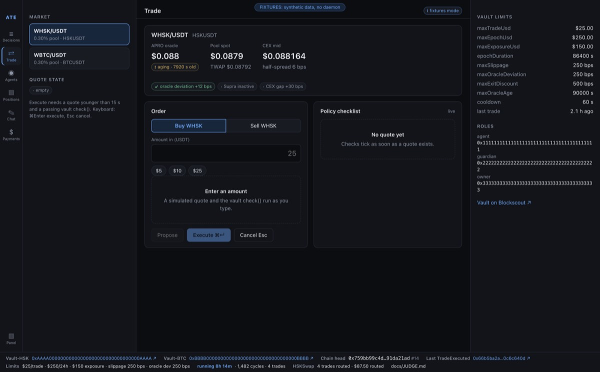 | 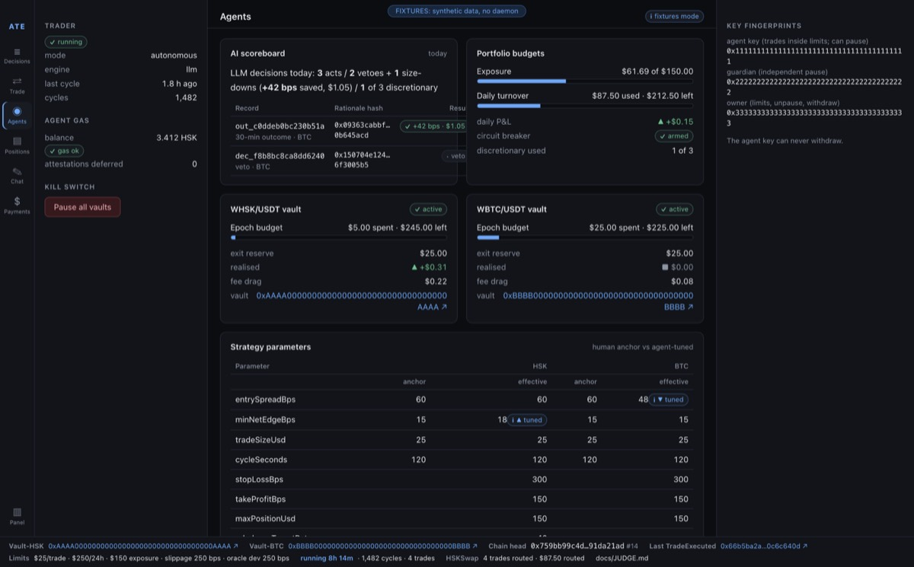 |

*These screens show the desktop app in fixtures mode. The data is sample data, not real testnet data. Captures from the real testnet come with the next app build.*

---

## 1. The problem and the answer

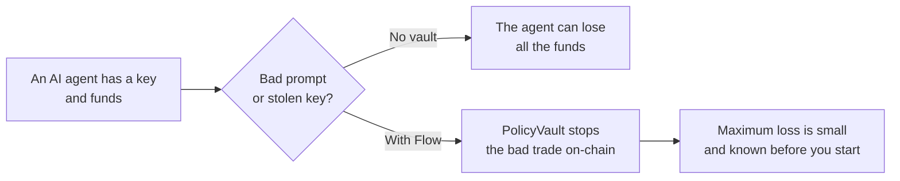

An AI agent with a wallet is a risk. One bad prompt or one stolen key can empty the wallet.

Flow puts the funds in a `PolicyVault` contract. The agent key can only do two things:
make a trade inside the limits, and pause the vault.
The agent key cannot withdraw funds. It cannot change the limits.

---

## 2. What Flow does

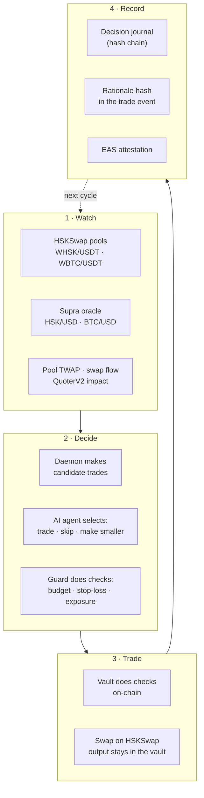

| Step | What Flow does |
|---|---|
| Watch | Flow reads on-chain data for each market: the pool price, the pool's 300 s TWAP, the oracle price (Supra, the price the vault checks), recent pool swaps and the price impact of a trade. |
| Decide | The daemon makes candidate trades. The AI trader selects one trade, or it makes no trade. The guard checks each trade. |
| Trade | The vault does a check of each limit. Then it swaps on HSKSwap. The output stays in the vault. |
| Record | Flow writes each decision to the journal. The vault writes the rationale hash on-chain. |

---

## 3. The parts

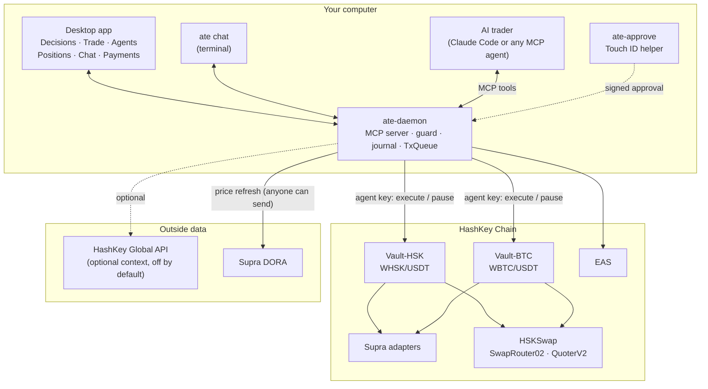

| Part | Folder | Function |
|---|---|---|
| PolicyVault | `contracts/src/PolicyVault.sol` | Holds the funds. Applies the limits on-chain. One vault for each market. |
| Supra adapter | `contracts/src/oracles/` | Gives the Supra price to the vault in the AggregatorV3 format. |
| Daemon | `apps/daemon`, `packages/*` | Runs the MCP server, the guard, the journal and the transaction queue. |
| AI trader | `agents/trader` | Calls an LLM each cycle. The AI trader selects trades with MCP tools. |
| Strategy | `packages/strategy` | Makes candidate trades. Applies the guard rules and the stop-loss. |
| Chat | `agents/chat`, `ate chat` | Lets you control the agent in plain language. |
| Desktop app | `apps/desktop` | Shows decisions, trades, positions and chat. |
| Approval helper | `apps/approve` | Signs human approvals with a Touch ID key. |
| Payments (optional) | `apps/worker`, `packages/payments` | Pays a signal agent through HSP. Not on the trade path. |

---

## 4. Who can do what

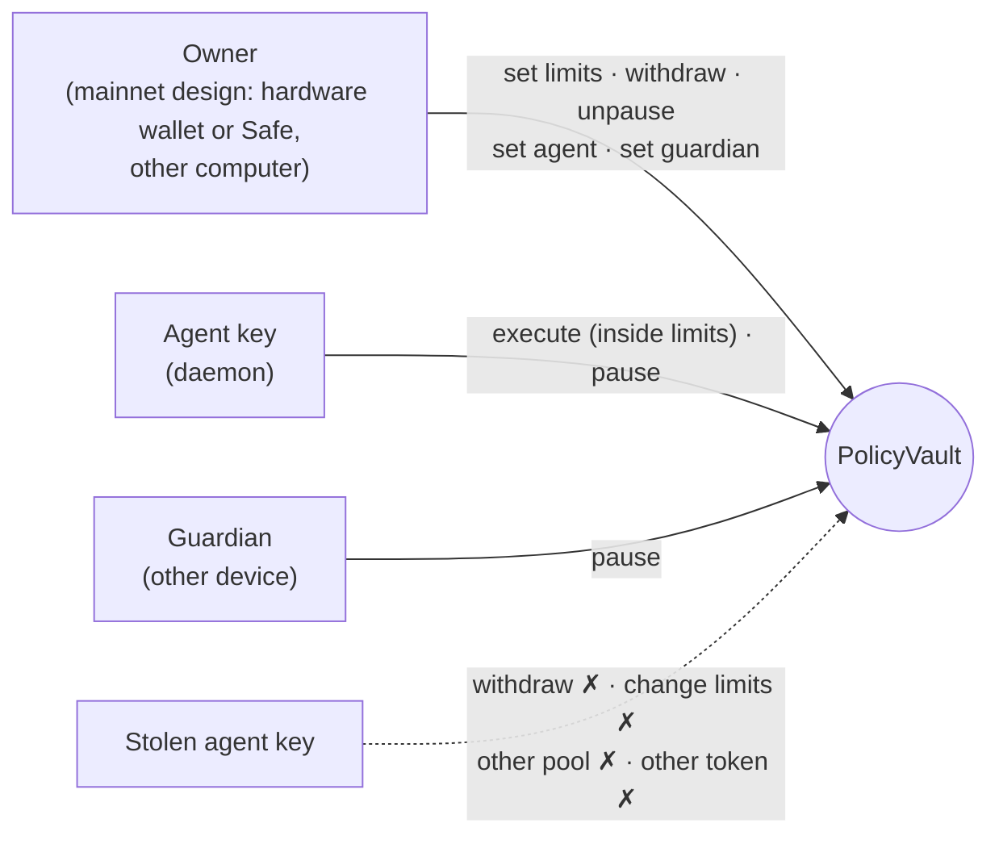

- Flow holds the owner key for you, so you never sign by hand. It lives in a separate owner service: its own
  process, its own credentials (a separate keychain item on the desktop, a separate secret or KMS key in the cloud).
  The agent, the trader and the chat have no route, token or credential that reaches it.
- The owner service decides what needs your approval by reading the chain. Raising a limit, unpausing, a new agent or
  guardian, a withdrawal or sending gas needs Touch ID (desktop) or your passkey (cloud), and the owner service
  checks that approval itself. Tightening a limit or pausing runs at once.
- What this changes: before, the owner key was on another device. Now Flow manages it, isolated from the agent but
  on the same machine or service. Someone who takes over the whole machine or container, not only the agent, could
  reach the owner key. A hacked or misled agent still cannot.
- The agent key can only trade inside the limits, and pause.
- Any key with a role can pause. Only the owner can unpause.
- The pool, the oracle and the router are fixed when you deploy the vault. Nobody can change them.

---

## 5. What the vault checks on each trade

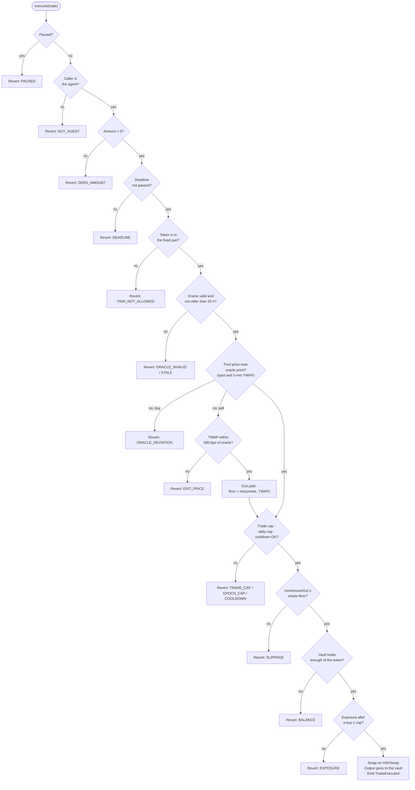

The vault calculates the minimum output from the oracle price.
The agent cannot give its own price. Thus a lie about the market has no effect.

`check()` gives the same reason code as `execute()`. Tests prove this for each code.
The diagram lists the checks in contract order.

---

## 6. The loss limit

| Item | Default value |
|---|---|
| Maximum trade | $100 |
| Daily budget for each vault (UTC day) | $250 |
| Maximum exposure for each vault, at each buy | $150 |
| Maximum loss, normal trades only, two vaults, one UTC day | $26.50 |
| Maximum loss, all trades incl. exit sells, one vault, one UTC day | $25.75 |
| Maximum loss, all trades incl. exit sells, two vaults, one UTC day | **$51.50** |
| Maximum loss, two vaults, any 24 hours | $103 |

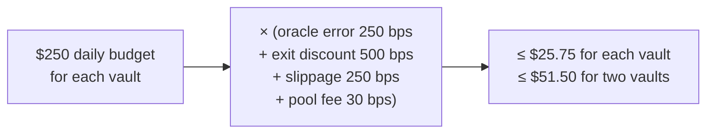

These limits apply when the Supra price is live and within 250 bps of the fair price.
The market price of the held tokens can also change. The stop-loss controls this risk, not the contract.
Refer to [`SPEC.md` §4.6](SPEC.md) for all conditions.

### Risk assumptions

- **The oracle can be up to 25 h old on testnet.** Supra pushes on HSK Chain every ~6 h or on a 0.5% move, and anyone can pull a fresh price with a proof. On testnet the pair barely moves, so a tight limit would block every trade. The price must still stay within 250 bps of the pool spot and TWAP.
- **Mainnet plan: `maxOracleAge` = 3 h (10,800 s)**, set at deploy with `MAX_ORACLE_AGE=10800` (the testnet contracts stay as deployed). 3 h is half of Supra's 6 h heartbeat, so a price that only the heartbeat refreshes is never trusted for more than half a cycle. The daemon runs the Supra pull with `refreshAgeSec` 3,600: it pulls a proof in the background whenever the price is older than 1 h, and again right before a trade if `check()` says `ERR_ORACLE_STALE` (or `ERR_ORACLE_DEVIATION` on a price older than 1 h). If the pull fails, the vault refuses the trade (fail closed: no trade, no loss).
- **Mainnet owner: a hardware wallet first, then a Safe.** The owner key (limits, withdraw, unpause, agent and guardian rotation) lives on a hardware wallet from the first mainnet deploy and moves to a Safe after that. It never sits on the agent's machine. The testnet owner is a hot deployer key.
- **USDT is valued at $1.** A buy is counted at its USDT amount.
- **An exit sell has a lower floor.** On the exit path the floor is min(oracle, TWAP). Spot is not checked there. This is the main attack: a stolen agent key plus a few minutes of TWAP manipulation on a thin pool can sell at up to 500 bps under the oracle. It is still capped by the exit loss bound above ($25.75 per vault per epoch).
- **The agent key can pause.** A stolen key can stop the vault. That stops trading and does not lose funds. It is a fail-safe. Only the owner can unpause.

---

## 7. One trading cycle

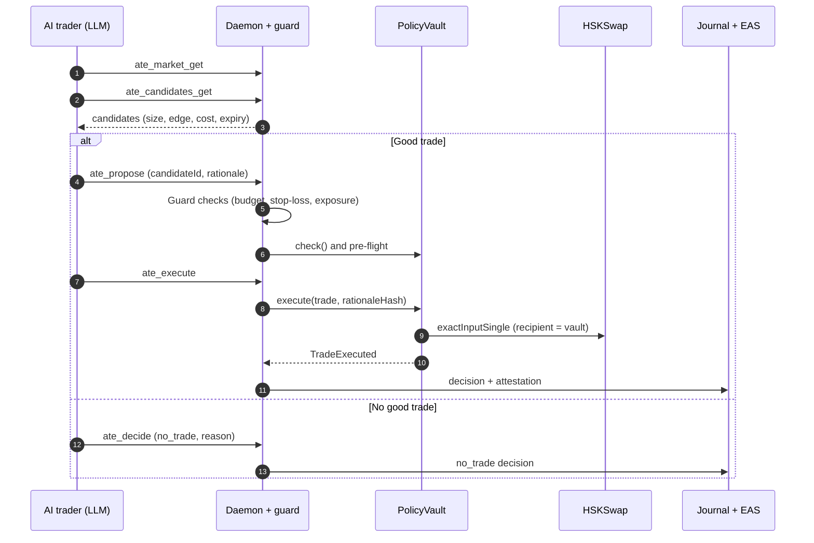

The cycle runs every 120 seconds. The daemon also runs a fast scan every 20 seconds.
If a large price gap opens, the daemon starts a cycle at once.

---

## 8. A bad agent cannot do damage

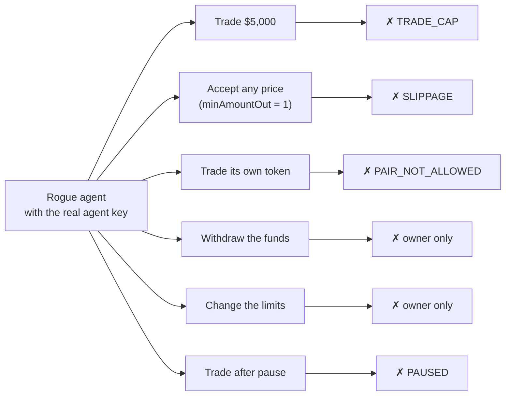

`ate rogue` sends each attack to the real vault. Each attack reverts on-chain.
You can see each revert on Blockscout with the decoded error.

---

## 9. Control in plain language

| You say | Flow does |
|---|---|
| "How am I doing today?" | Shows positions and P&L. |
| "Go to cash on HSK, keep the BTC" | Sells the WHSK at once. Keeps the WBTC. |
| "Stop out HSK at 2%" | Sets the stop-loss for the HSK market. |
| "Why did you sell at 3 am?" | Shows the journal record and the rationale. |
| "Stop everything" | Pauses the vaults. The testnet proof shows a guardian pause, a refused trade and an owner unpause on both vaults. |
| "Raise the daily cap to $800" | Refuses. Only the owner can change the limits. |

A change that increases the risk needs approval: Touch ID, or a one-time code shown by the daemon.
A change that decreases the risk applies at once.

---

## 10. How to run Flow

Do these steps in the repository root. Use pnpm 9: `npx -y pnpm@9.15.0`.
These steps run on the testnet (chain 133), which is live today. Mainnet uses `deployments/177.json` after deployment.

1. Install the packages.
   ```sh
   npx -y pnpm@9.15.0 install
   ```
2. Build all packages.
   ```sh
   npx -y pnpm@9.15.0 -r build
   ```
3. Test all packages.
   ```sh
   npx -y pnpm@9.15.0 -r test
   ```
4. Test the contracts.
   ```sh
   cd contracts && forge test
   ```
5. Make the testnet config. Then make an agent key. To use the vaults in `deployments/133.json`, import their agent key. To use your own vaults, deploy them first ([`docs/TESTNET.md`](docs/TESTNET.md)).
   ```sh
   node apps/daemon/scripts/testnet-config.mjs deployments/133.json ~/.ate-testnet/config.json --enable-strategy
   ATE_HOME=~/.ate-testnet ATE_KEYSTORE=file node apps/daemon/dist/bin.js keygen
   ```
6. Start the daemon.
   ```sh
   ATE_HOME=~/.ate-testnet ATE_KEYSTORE=file ATE_DEPLOYMENTS=deployments/133.json \
     node apps/daemon/dist/bin.js start --approval-fallback=armed
   ```
7. Do a health check.
   ```sh
   ATE_HOME=~/.ate-testnet npx tsx apps/cli/src/bin.ts doctor
   ```
8. Start the AI trader.
   ```sh
   ATE_HOME=~/.ate-testnet npx tsx apps/cli/src/bin.ts agent run --model sonnet --deployments deployments/133.json
   ```
9. Open the desktop app. Use fixtures mode if no daemon runs.
   ```sh
   cd apps/desktop && npx -y pnpm@9.15.0 dev        # or: dev:fixtures
   ```

### Run Flow in the cloud

The same app runs as a web app: one container with three processes. The gateway serves the app and handles
sign-in (passkey, or a password as a fallback). The owner service holds the owner key. The daemon runs the agent and
the trader. TLS comes from the host.

```sh
docker build -t flow-cloud .
docker run -p 8080:8080 -v flow-data:/data -e FLOW_ORIGIN=https://flow.example.com -e FLOW_PASSWORD=… \
  -e ATE_AGENT_SIGNER=secret -e ATE_AGENT_KEY_ENC=… -e ATE_AGENT_KEY_SECRET=… \
  -e ATE_OWNER_SIGNER=secret -e ATE_OWNER_KEY_ENC=… -e ATE_OWNER_KEY_SECRET=… flow-cloud
```

`ATE_<ROLE>_KEY_ENC` is a key sealed with scrypt and AES-GCM for that role (`flow-owner seal` makes the owner one).
For KMS, set `ATE_<ROLE>_SIGNER=kms` and `ATE_<ROLE>_KMS_KEY_ID` (an `ECC_SECG_P256K1` key), and give the owner key
its own IAM principal. `/healthz` reports the gateway, the daemon and the owner service.
`scripts/cloud-deploy-branch.sh --push` builds the `cloud-deploy` branch the host builds the image from.

For all testnet commands, refer to [`docs/TESTNET.md`](docs/TESTNET.md).
For the deployment to the mainnet (chain 177), refer to [`contracts/README.md`](contracts/README.md).

---

## 11. Networks and contracts

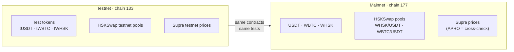

| Item | Mainnet (177) |
|---|---|
| HSKSwap factory | `0x972cA9D1662F5e029cD18327D29026532E84c742` |
| SwapRouter02 | `0x2c16f75b95Cf1390c328aB70e2CEE7f4b80bD8F3` |
| QuoterV2 | `0x603f70466fDdbE3F238220B9a74FFF419a2BbFDD` |
| WHSK/USDT pool | `0x4ff515761864e7838b0adb8b5b2b8b7a068905dc` |
| WBTC/USDT pool | `0xd9EA2cE468957Ba49cCC38C4758Ed6ecD561449A` |
| Supra storage | `0x58e158c74DF7Ad6396C0dcbadc4878faC9e93d57` (HSK = pair 517, BTC = pair 0) |
| EAS | `0x4200000000000000000000000000000000000021` |
| Vaults | Testnet: `deployments/133.json`. Mainnet: `deployments/177.json` after deployment. |

---

## 12. Tests

| Area | Tests |
|---|---|
| Contracts (unit, parity, invariant, fork smoke) | 148 pass, 5 fork tests skipped (opt-in) |
| Strategy and guard | 97 pass |
| Daemon, MCP, journal, chain, oracle, wallet | 86 pass |
| Approvals, payments, worker | 60 pass |
| Core, trader, chat, CLI | 77 pass (1 chat test skipped) |

The fork smoke test (optional, `FORK_SMOKE=true`) uses the real HSKSwap pools and the real Supra prices.
It does a buy, a sell and an exit-path sell on each vault.

---

## 13. HashKey products that Flow uses

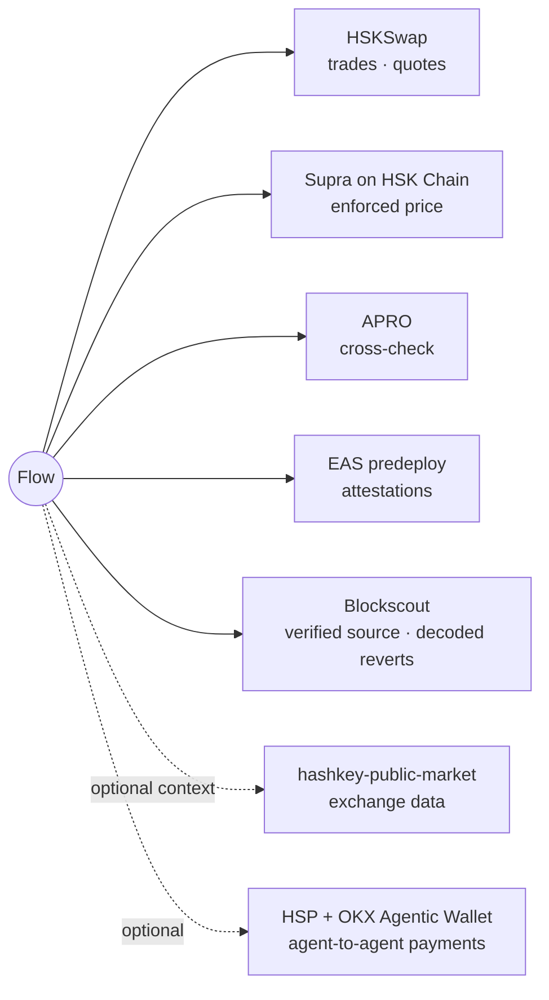

---

## 14. What this version does not do

- The spread trade has one leg. Flow does not trade on the exchange.
- The pools have low volume. The 7-day replay shows many gaps, but most counterfactual lots stay open at a loss. It does not prove profit.
  Refer to [`docs/replay-7d.md`](docs/replay-7d.md). That report used the earlier reference (the HashKey Global price). `ate replay` now measures each pool against its own 300 s TWAP from the swap logs, because the Supra oracle keeps no price history that we can read.
- The WBTC pool price can stay away from the oracle price for days. Each trade is one leg on HSKSwap, so a gap is a profit only if the pool moves back.
- Flow does not trade between two HSKSwap pools of the same asset. Each vault has one pool.
- HSP payments are optional. They need access from the HSP operations team.
- Each vault supports one fixed pool. A new pool needs a new vault.

---

## 15. What comes next

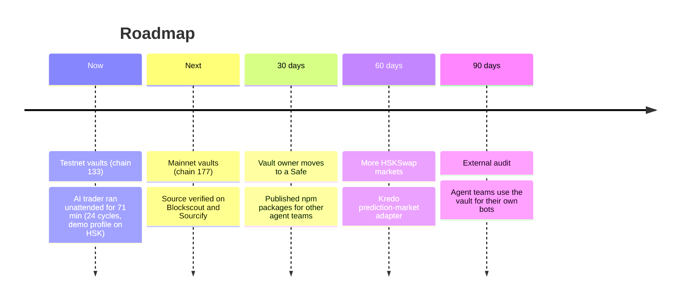

Do you build an AI agent on HashKey Chain? Use the vault for your own bot.
Refer to [`docs/INTEGRATE.md`](docs/INTEGRATE.md). Contact: team Vikings, akash.jsmith@gmail.com.

