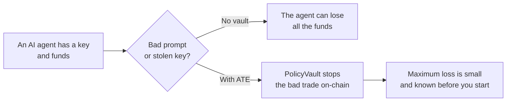
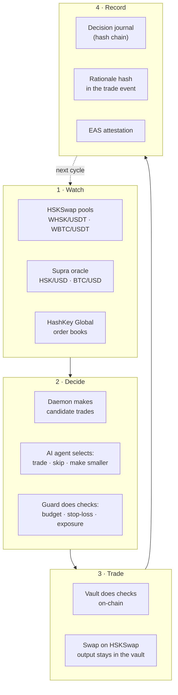
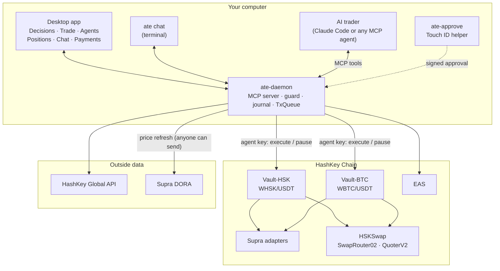
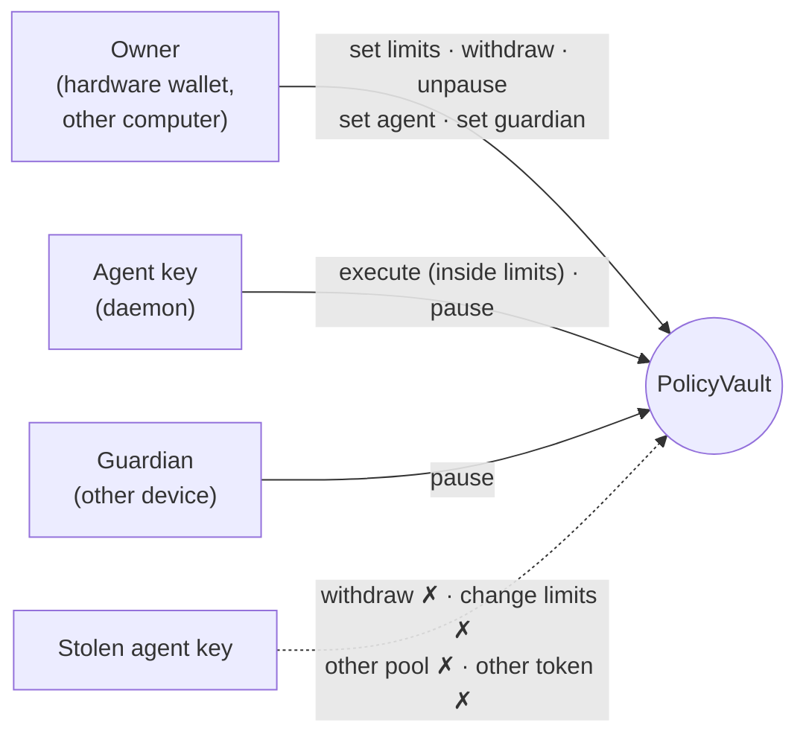
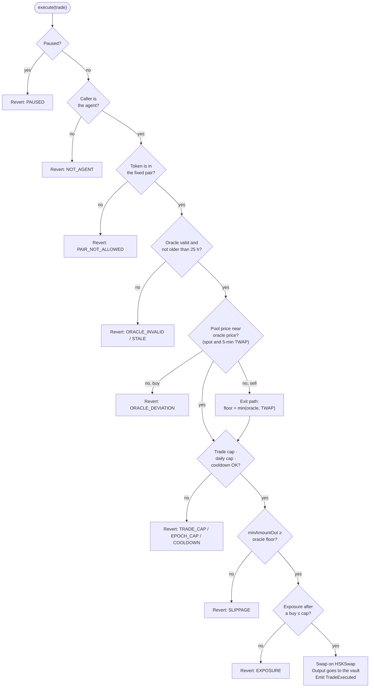
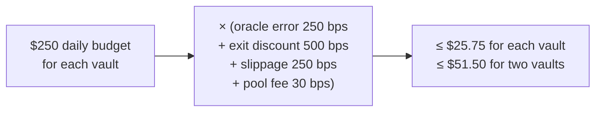
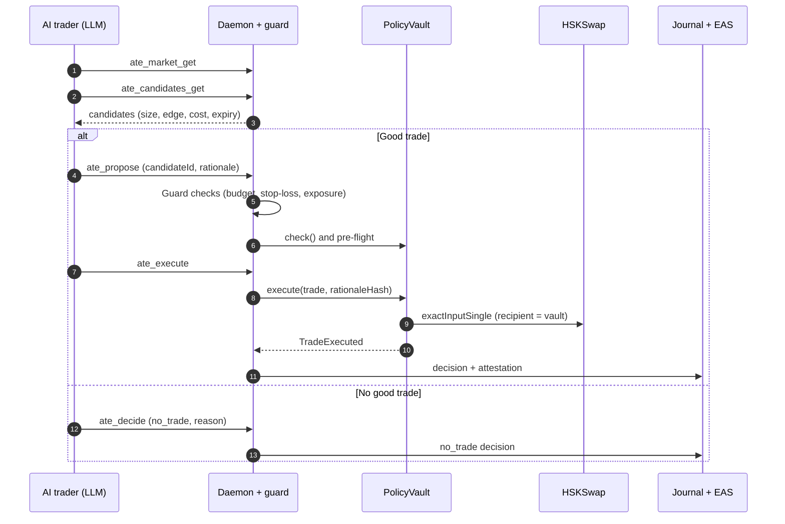
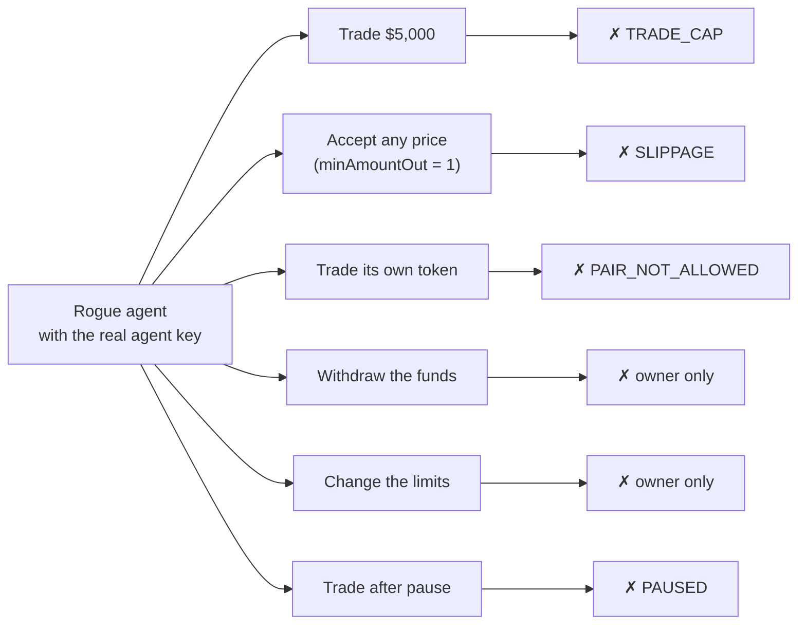
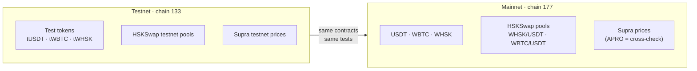
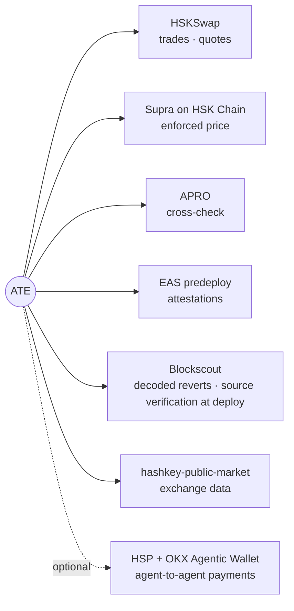

# ATE — Agentic Trading Environment

**A seatbelt for AI traders.** Let an AI agent trade on HSKSwap by itself,
and know before you start how much it can lose.

You give the agent a budget. A contract on HashKey Chain holds the money and checks every trade.
If the agent makes a mistake, gets a bad prompt or loses its key, the contract stops the trade.

Built by team Vikings for the HSK Chain Horizon Hackathon (AI Agent Trading). Apache-2.0.

## Where things are

| Item | Status |
|---|---|
| Contracts | Done. 148 tests pass. An optional fork test also runs them against the real HSKSwap pools and Supra prices. |
| Testnet (chain 133) | Deploying now. Addresses go in `deployments/133.json`. |
| Mainnet (chain 177) | Next. The same scripts deploy it. |
| AI trader | Claude (Sonnet) through Claude Code. You can plug in any MCP agent. |
| Profit | Not promised. The pools are thin. What ATE gives you is a hard limit on loss. |

## Why a vault, and not a normal wallet

| What you want | Token allowance | Safe module or session key | ATE PolicyVault |
|---|---|---|---|
| Limit on trade size and daily spend | No | Yes | Yes |
| Refuse a trade at a bad price | No | No | Yes, from an oracle price |
| Only one pool, one oracle, one router | No | Partly | Yes, fixed at deploy |
| Limit on how much of a token the agent holds | No | No | Yes |
| A record of why each trade happened | No | No | Yes, hash on-chain |
| Works with any AI agent through MCP | No | No | Yes |

More detail: [`SPEC.md`](SPEC.md) (full design) · [`docs/JUDGE.md`](docs/JUDGE.md) (links to transactions and proofs) · [`docs/replay-7d.md`](docs/replay-7d.md) (7-day market replay).

---

## 1. The problem and the answer



An AI agent with a wallet is a risk. One bad prompt or one stolen key can empty the wallet.

ATE puts the funds in a `PolicyVault` contract. The agent key can only do two things:
make a trade inside the limits, and pause the vault.
The agent key cannot withdraw funds. It cannot change the limits.

---

## 2. What ATE does



| Step | What ATE does |
|---|---|
| Watch | ATE reads the pool price, the oracle price and the exchange price for each market. |
| Decide | The daemon makes candidate trades. The AI trader selects one trade, or it makes no trade. The guard checks each trade. |
| Trade | The vault does a check of each limit. Then it swaps on HSKSwap. The output stays in the vault. |
| Record | ATE writes each decision to the journal. The vault writes the rationale hash on-chain. |

---

## 3. The parts



| Part | Folder | Function |
|---|---|---|
| PolicyVault | `contracts/src/PolicyVault.sol` | Holds the funds. Applies the limits on-chain. One vault for each market. |
| Supra adapter | `contracts/src/oracles/` | Gives the Supra price to the vault in the AggregatorV3 format. |
| Daemon | `apps/daemon`, `packages/*` | Runs the MCP server, the guard, the journal and the transaction queue. |
| AI trader | `agents/trader` | Calls an LLM each cycle. The AI trader selects trades with MCP tools. |
| Strategy | `packages/strategy` | Makes candidate trades. Applies the guard rules and the stop-loss. |
| Chat | `agents/chat`, `ate chat` | Lets you control the agent in plain language. |
| Desktop app | `apps/desktop` | Shows decisions, trades, positions and chat. |
| Approval helper | `apps/approve` | Signs human approvals with a Touch ID key. |
| Payments (optional) | `apps/worker`, `packages/payments` | Pays a signal agent through HSP. Not on the trade path. |

---

## 4. Who can do what



- The owner key is never on the agent computer.
- The agent key can only trade inside the limits, and pause.
- Any key with a role can pause. Only the owner can unpause.
- The pool, the oracle and the router are fixed when you deploy the vault. Nobody can change them.

---

## 5. What the vault checks on each trade



The vault calculates the minimum output from the oracle price.
The agent cannot give its own price. Thus a lie about the market has no effect.

`check()` gives the same reason code as `execute()`. Tests prove this for each code.

---

## 6. The loss limit

| Item | Default value |
|---|---|
| Maximum trade | $100 |
| Daily budget for each vault (UTC day) | $250 |
| Maximum exposure for each vault, at each buy | $150 |
| Maximum loss, normal trades only, two vaults, one UTC day | $26.50 |
| Maximum loss, all trades incl. exit sells, one vault, one UTC day | $25.75 |
| Maximum loss, all trades incl. exit sells, two vaults, one UTC day | **$51.50** |
| Maximum loss, two vaults, any 24 hours | $103 |



These limits apply when the Supra price is live and within 250 bps of the fair price.
The market price of the held tokens can also change. The stop-loss controls this risk, not the contract.
Refer to [`SPEC.md` §4.6](SPEC.md) for all conditions.

---

## 7. One trading cycle



The cycle runs every 120 seconds. The daemon also runs a fast scan every 20 seconds.
If a large price gap opens, the daemon starts a cycle at once.

---

## 8. A bad agent cannot do damage



`ate rogue` sends each attack to the real vault. Each attack reverts on-chain.
You can see each revert on Blockscout with the decoded error.

---

## 9. Control in plain language

| You say | ATE does |
|---|---|
| "How am I doing today?" | Shows positions and P&L. |
| "Go to cash on HSK, keep the BTC" | Sells the WHSK at once. Keeps the WBTC. |
| "Stop out HSK at 2%" | Sets the stop-loss for the HSK market. |
| "Why did you sell at 3 am?" | Shows the journal record and the rationale. |
| "Stop everything" | Pauses both vaults. |
| "Raise the daily cap to $800" | Refuses. Only the owner can change the limits. |

A change that increases the risk needs a Touch ID approval.
A change that decreases the risk applies at once.

---

## 10. How to run ATE

Do these steps in the repository root. Use pnpm 9: `npx -y pnpm@9.15.0`.

1. Install the packages.
   ```sh
   npx -y pnpm@9.15.0 install
   ```
2. Build all packages.
   ```sh
   npx -y pnpm@9.15.0 -r build
   ```
3. Test all packages.
   ```sh
   npx -y pnpm@9.15.0 -r test
   ```
4. Test the contracts.
   ```sh
   cd contracts && forge test
   ```
5. Make an agent key.
   ```sh
   node apps/daemon/dist/bin.js keygen
   ```
6. Start the daemon.
   ```sh
   node apps/daemon/dist/bin.js start --approval-fallback=armed
   ```
7. Do a health check.
   ```sh
   npx tsx apps/cli/src/bin.ts doctor
   ```
8. Start the AI trader.
   ```sh
   npx tsx apps/cli/src/bin.ts agent run --model sonnet
   ```
9. Open the desktop app. Use fixtures mode if no daemon runs.
   ```sh
   cd apps/desktop && npx -y pnpm@9.15.0 dev        # or: dev:fixtures
   ```

For the testnet (chain 133), refer to [`docs/TESTNET.md`](docs/TESTNET.md).
For the deployment to the mainnet (chain 177), refer to [`contracts/README.md`](contracts/README.md).

---

## 11. Networks and contracts



| Item | Mainnet (177) |
|---|---|
| HSKSwap factory | `0x972cA9D1662F5e029cD18327D29026532E84c742` |
| SwapRouter02 | `0x2c16f75b95Cf1390c328aB70e2CEE7f4b80bD8F3` |
| QuoterV2 | `0x603f70466fDdbE3F238220B9a74FFF419a2BbFDD` |
| WHSK/USDT pool | `0x4ff515761864e7838b0adb8b5b2b8b7a068905dc` |
| WBTC/USDT pool | `0xd9EA2cE468957Ba49cCC38C4758Ed6ecD561449A` |
| Supra storage | `0x58e158c74DF7Ad6396C0dcbadc4878faC9e93d57` (HSK = pair 517, BTC = pair 0) |
| EAS | `0x4200000000000000000000000000000000000021` |
| Vaults | Refer to `deployments/177.json` and `deployments/133.json` after deployment. |

---

## 12. Tests

| Area | Tests |
|---|---|
| Contracts (unit, parity, invariant, fork smoke) | 148 pass, fork tests opt-in |
| Strategy and guard | 97 pass |
| Daemon, MCP, journal, chain, oracle, wallet | 78 pass |
| Approvals, payments, worker | 60 pass |
| Core, trader, chat, CLI | 66 pass |

The fork smoke test (optional, `FORK_SMOKE=true`) uses the real HSKSwap pools and the real Supra prices.
It does a buy, a sell and an exit-path sell on each vault.

---

## 13. HashKey products that ATE uses



---

## 14. What this version does not do

- The spread trade has one leg. ATE does not trade on the exchange.
- The pools have low volume. The 7-day replay shows many gaps, but most counterfactual lots stay open at a loss. It does not prove profit.
  Refer to [`docs/replay-7d.md`](docs/replay-7d.md).
- The WBTC pool price can stay below the exchange price for days.
- HSP payments are optional. They need access from the HSP operations team.
- Each vault supports one fixed pool. A new pool needs a new vault.
