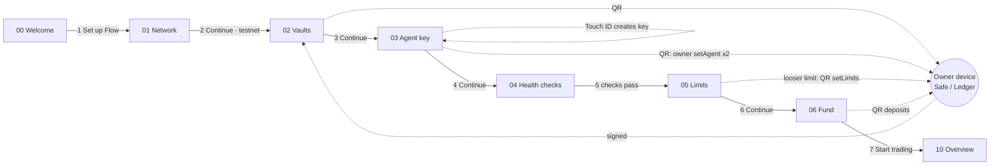
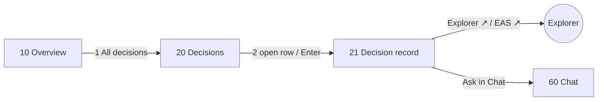
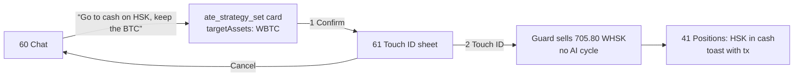
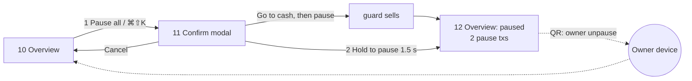
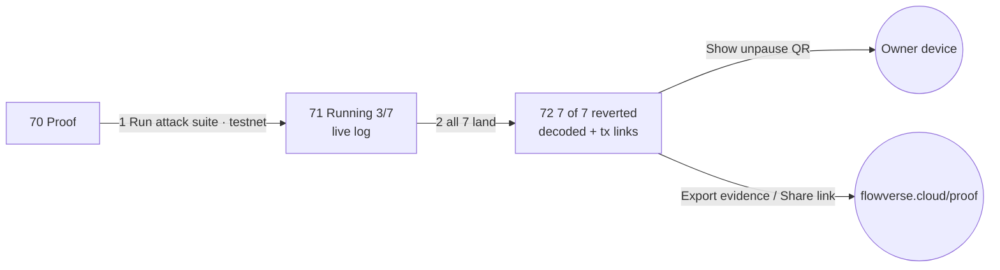

# Flow: production v1 user flow

`index.html` + `flow.css` in this folder are the high-fidelity flow board: every screen at 1440 × 900, the
five primary journeys wired with numbered hotspots, and state variants. Open `index.html` in Chrome; add
`?f=<frame-id>` (for example `?f=10-overview`) to see one frame alone at full size. Fonts and brand marks
load from `packages/ui` by relative path (`node_modules` for fonts, `brand/` for the logo); nothing is
copied in. Design language: [`../DESIGN-LANGUAGE.md`](../DESIGN-LANGUAGE.md). Tokens: `packages/ui/src/tokens.css`.

Content uses the real testnet (chain 133) deployment from `deployments/133.json`: Vault-HSK
`0xF80A74F4D9C17Db8a2a0F32558a9FC3A63e2Bcd2`, Vault-BTC `0x6Da0c6EF7328d3aD6b0b8781770D941D065a6693`,
agent `0xC11C…4f8a`, guardian `0x8aAc…b66B`, owner `0xFF7D…569e`, limits $100 per trade, $250 per UTC day,
$150 exposure per vault, and a worst case of $51.50 per UTC day across both vaults ($250 × 1030 bps per
vault). Decision and attack tx hashes are illustrative.

**Rule for v1: no step needs a terminal.** Setup, unlock, health checks, keys, limits, funding,
deploy status and the attack proof all run in the app. Owner and guardian keys never touch the Mac: any
owner action (prove ownership, set agent, change a limit, deposit, unpause) is a QR handoff to a Safe or
hardware wallet on another device.

## Shell

- 76 px dark rail: brand mark, Overview, Decisions, Markets, Positions, Agent, Chat, Proof, Payments
  (disabled, "SOON"), trader status, Settings.
- Optional 236 px context panel (filters, market list) and 320 px dark inspector.
- **Evidence footer on every screen**, including setup: both vault addresses (explorer links), chain head,
  last trade tx, `limits()` summary with the $51.50 bound, uptime / cycles / trades (or PAUSED,
  RECONNECTING, SETUP n/6), HSKSwap trades routed, network and block, `flowverse.cloud/proof`.
- Touch ID covers anything that loosens risk, sells right now, or saves settings.

## Screen inventory

| # | Screen | Purpose | Key content | Primary action | States drawn |
|---|---|---|---|---|---|
| 00 | Welcome | First launch: the promise | "Let an AI trade. Know the worst case first."; three default-limit promises (key can never withdraw, ≤ $51.50/day, ≤ $150/vault); agent → vault → HSKSwap strip | **Set up Flow** | — |
| 01 | Setup · Network | Pick testnet or mainnet | Testnet 133 / mainnet 177 cards, RPC latency and block, explorer, oracle | Continue | testnet selected |
| 02 | Setup · Vaults | Connect or deploy the two PolicyVaults | Found deployment, both vaults with verified source, pinned pool, Supra pair, limits; owner-device QR, signed proof, `owner()` match | Continue (after QR sign) | connect existing; deploy new is a tab |
| 03 | Setup · Agent key | Create the agent key in-app | Address, Secure Enclave + Touch ID unlock, can / can never lists, owner `setAgent` txs via QR, gas | Continue | gas check running |
| 04 | Setup · Health checks | Live checklist, no CLI `doctor` | 18 checks in 3 groups (chain & vaults, prices & pools, services), dry-run `check()` | Continue | 16 pass, 1 running, 1 warning |
| 05 | Setup · Limits | Set limits, see the loss bound live | 7 limits with sliders; live $51.50 card with bps breakdown (250 + 500 + 250 + 30), per vault, normal path, rolling 24 h, % of deposit | Continue | matches on-chain (no owner tx needed) |
| 06 | Setup · Fund | Deposit and start | Per-vault deposits with txs, totals, worst day %, trader mode | **Start trading** | funded |
| 10 | Overview | Home: am I safe, is it working | Worst-case loss used vs max today ($6.44 of $51.50), per vault; P&L realised / if sold now; **kill switch**; budget and exposure per vault; last decisions; AI scoreboard; inspector: uptime, health, keys | Pause all; All decisions | running · 13 empty · 14 loading · 15 error · 12 paused |
| 11 | Kill switch confirm | Make the stop deliberate | What pausing does, that stop-loss exits stop too ($86.91 unprotected), owner-only unpause; pause now vs go to cash first | **Hold to pause** | — |
| 20 | Decisions | Journal timeline | Filters (kind, market, decided-by), day groups, rows with market, reason, AI/guard, result; inspector with selected record, tx, EAS, hash chain | Open record | list with selection |
| 21 | Decision record | One decision, fully explained | Supra / pool / HashKey Global prices, rationale, gap vs cost gauge, 13 of 13 vault checks, tx, min out, gas, EAS; hash chain matches on-chain | Explorer / EAS links | executed |
| 30 | Markets | Prices, gap, cost, candidates | Three prices, gap vs cost, 6 h gap chart, live candidates, vault limits; **Advanced: manual order** collapsed | Refresh Supra | live · 31 empty · 32 loading · 33 error (oracle stale) · 34 paused |
| 40 | Positions | What I hold and what it's worth | In vaults, realised, if sold now, CEX mark; per market avg cost, stop-loss, lots; portfolio guard | Go to cash (per market) | holding both · 41 HSK in cash |
| 50 | Agent | Who decides and how boldly | Model, mode, risk profile; strategy yours vs agent-tuned with allowed range; pending Touch ID approvals; pause trader vs kill switch | Approve · Touch ID; Pause trader | 1 approval pending |
| 60 | Chat | Plain-language control | Messages with tool cards (`ate_positions`, `ate_strategy_set`), inline confirm, quick prompts; inspector: what chat can / can never do | Confirm with Touch ID | awaiting confirm · 61 Touch ID sheet |
| 70 | Proof | Trust: what the contract refuses | 7/7 last run, decoded reverts with tx links, pause/unpause history, tests and invariants | **Run attack suite** (testnet only) | idle · 71 running · 72 result |
| 80 | Payments | HSP payments, not in v1 | Greyed page, "Connect HSP — coming soon", rail item disabled with tooltip | (disabled) | coming soon |
| 90 | Settings | RPCs, oracle refresh, approval key, network | Cards per area, unsaved diff bar | **Save with Touch ID** | 3 unsaved |

## Journeys

### A · First run



### B · Daily check



### C · Control in words



Note: SPEC §11.5 classes "go to cash" as tightening, which applies without a signature. v1 still asks for a
Touch ID **confirmation** because it sells immediately. Loosening changes (for example "back to a 3% stop")
need Touch ID as an approval and also show in Agent → Waiting for you.

### D · Safety



### E · Trust



The seven on-chain attacks and the decoded errors they must produce: $5,000 buy → `TradeCap`; buy past
exposure → `Exposure`; `minAmountOut = 1` → `Slippage`; fake token → `PairNotAllowed`; `withdraw` →
`NotOwner`; `setLimits` → `NotOwner`; trade after guardian pause → `VaultPaused`. On mainnet the button
is replaced by links to recorded runs.

## States

| Screen | Empty | Loading | Error | Paused |
|---|---|---|---|---|
| Overview | 13: trader just started, $0.00 used, "No decisions yet" | 14: skeleton, "Reading limits() and balances…" | 15: RPC unreachable banner, stale values dimmed, fallback RPC button; footer RECONNECTING | 12: paused banner, kill switch card turns into an unpause QR, vaults badged paused |
| Markets | 31: no market enabled, enable button | 32: skeleton | 33: Supra older than 25 h, buys refused (`OracleStale`), refresh button | 34: paused banner, candidates not traded |

## Rendering

```sh
CH="/Applications/Google Chrome.app/Contents/MacOS/Google Chrome"
"$CH" --headless=new --hide-scrollbars --screenshot=out.png --window-size=1440,900 "file://$PWD/docs/design/flow/index.html?f=10-overview"
"$CH" --headless=new --hide-scrollbars --screenshot=board.png --window-size=7200,6400 "file://$PWD/docs/design/flow/index.html"
```

PNGs are not committed.
